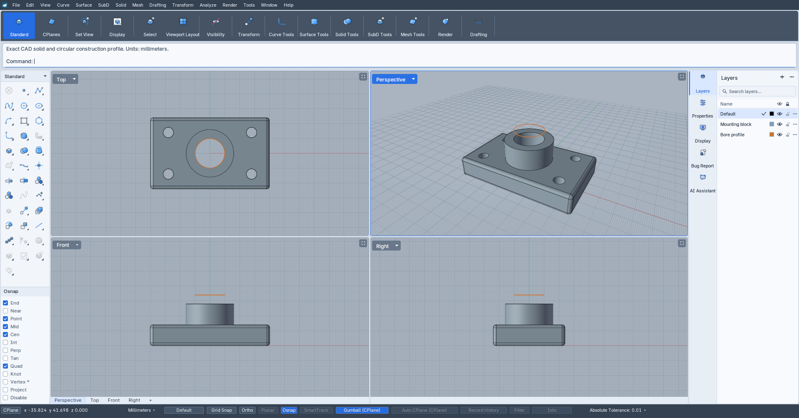
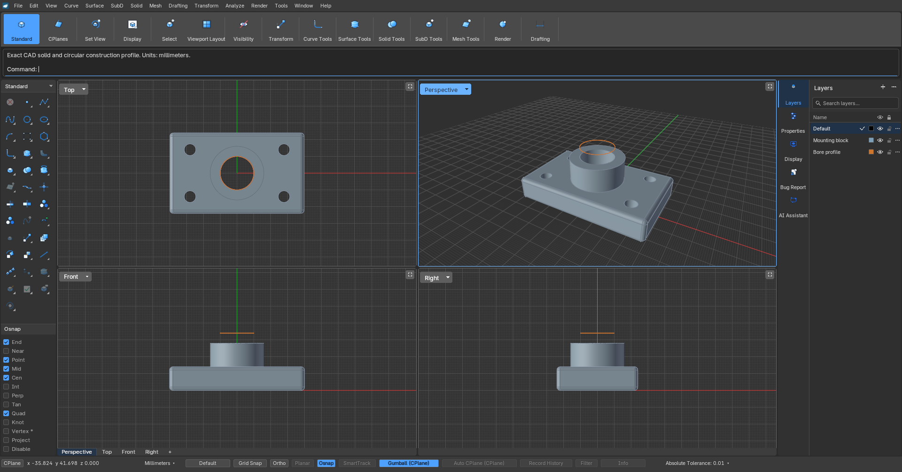

<p align="center">
  
</p>

<h1 align="center">Narwhal 3D</h1>

<p align="center"><strong>Free, open-source CAD for precise curves, smooth surfaces, and solid models.</strong></p>

Draw with the mouse, type a command, or choose a tool from the sidebar. Work in four views at once, shape your model with on-screen handles, and choose a light or dark workspace.

**[Download for Linux](https://github.com/ContributionRich/Narwhal3D/releases/download/v0.4.13/Narwhal_3D-0.4.13-x86_64.AppImage)** · **[Download for Windows](https://github.com/ContributionRich/Narwhal3D/releases/download/v0.4.13/Narwhal_3D-0.4.13-Windows-x86_64.exe)** · [What's new](CHANGELOG.md)

> **Current release: [0.4.13](https://github.com/ContributionRich/Narwhal3D/releases/tag/v0.4.13).** The Linux AppImage and Windows portable EXE include the new Library tab, background native-project Save/Open, crash recovery, command and print/unit fixes, and further Rust conversions. TracePicture remains included. Both packages use the tagged release source. The Windows EXE is unsigned and was tested in a Windows 11 VM with software OpenGL, not a physical GPU. See [release notes](CHANGELOG.md) and [current status](STATUS.md).

> **An early preview, built in the open.** Narwhal is still growing, and some tools are incomplete. Save important work often and verify dimensions and exported geometry before manufacturing. [See what works and what's still missing →](docs/gaps.md)

**Pending source: 0.4.14.** [Candidate changes and current limitations](CHANGELOG.md#0414--source-candidate-not-yet-published). Downloads above remain the published 0.4.13 packages until the new release is qualified and published.

## Your workspace, light or dark

The same model in **Narwhal 3D 0.4.7**.

### Light

A bright interface with grey viewports and clear outlines.



### Dark

A charcoal workspace with the same tools and layout.



Switch at any time with **View → Theme**. Your choice is remembered the next time you launch.

## From a sketch to a solid

| Start with… | Then… |
|---|---|
| **Curves and profiles** | Draw lines, arcs, circles, and smooth curves with precise coordinates and snapping. |
| **Surfaces** | Extrude a profile, loft between curves, or sweep a section along a rail. |
| **Solid parts** | Combine or subtract shapes, drill openings, and round edges with fillets. |
| **Direct editing** | Move, rotate, scale, and extrude with the gumball—the handles attached to your selection. |

**Precision is more than appearance.** Curved geometry stays smooth and exact; the triangles used to draw the viewport are not a substitute for your model. Unsupported operations should report a limitation rather than silently approximate a result.

[Explore the current features](STATUS.md) · [Read the roadmap](ROADMAP.md) · [Browse the release notes](CHANGELOG.md)

## Get started

### Linux

Download the **AppImage** above. In your file manager, open its properties, allow it to run as a program, and launch it. Or, from the folder containing the download:

```bash
chmod +x Narwhal_3D-0.4.13-x86_64.AppImage
./Narwhal_3D-0.4.13-x86_64.AppImage
```

The application is bundled—no separate Blender installation is needed. The download is for **x86_64 Linux**; desktop and graphics-driver compatibility still varies. [Platform details](docs/technical-reference.md#install-on-linux-x86_64)

### Windows

The 0.4.13 **portable EXE**, `Narwhal_3D-0.4.13-Windows-x86_64.exe`, manages its payload in a private per-user cache; no manual extraction is required. Its first launch prepares that cache. Keep user documents outside the replaceable application cache. Compare its download with the published `.sha256` checksum.

The v0.4.13 release publishes only the EXE and its checksum. The 0.4.8 portable ZIP stays on the 0.4.8 release page unchanged for compatibility; if you installed that ZIP, download the 0.4.13 EXE once. Future Windows releases will also publish only the EXE and its checksum.

This is an **unsigned early preview**, so Windows may display a SmartScreen warning. The EXE was accepted in a Windows 11 virtual machine using a software OpenGL driver, not a physical GPU, and testing on physical Windows GPUs remains limited. There is no installer yet. [Windows details](docs/windows-build.md)

### Try your first model

1. Start a new model and choose a view.
2. Draw a circle using the toolbar or the `Circle` command.
3. Select it, then run `ExtrudeCrv` and enter a distance.
4. Use the gumball handles to move, rotate, or scale the result.
5. Save your project as **`.narwhal`**.

## Reuse assets with Library

**Included in the 0.4.13 Linux and Windows packages.**

The Library tab sits between Bug Report and AI Assistant. Organize exact assets
into categories, capture selected geometry, import files, and click or drag tiles
to insert independent copies with ordinary Undo/Redo. Share collections as
`.narwhallib` packages. See [Library usage and fidelity limits](docs/LIBRARY.md).

Native project Open and cold Library placement prepare/validate files in the
background, keeping the current document active until a candidate is ready.
Rust owns the load and Save/AutoSave queues as well as native container I/O;
exact geometry, recovery and the ordinary Undo history are preserved.
See [background file I/O, scope and remaining host work](docs/FILE_IO.md).
Foreign-format imports and some scene/thumbnail work still use the main thread; background native-project I/O does not promise zero pauses for every asset.


## Save and share your work

- **`.narwhal`** is the native project format. Use it to save and reopen your work.
- **STEP** is the recommended interchange format for exact solid geometry.
- Other supported formats include **`.3dm`, DXF, SVG, OBJ, STL, and CorelDRAW**, with different capabilities and limitations for each.

Some solids cannot yet be exported as exact `.3dm` geometry, and the macOS package does not include the exact-save helper yet. Use STEP for exact solid exchange, and check the [format and geometry details](docs/technical-reference.md#geometry-model) before depending on a particular workflow.

## Help shape Narwhal

**Found a bug?** Open the **Bug Report** tab inside the app, or [report an issue on GitHub](https://github.com/ContributionRich/Narwhal3D/issues/new/choose). Include what you were doing, what you expected, and a screenshot if useful. Reports and attachments are not uploaded automatically—you review what you share.

**Have an idea or want to contribute?** Feedback, testing, documentation, design, and code are welcome. Start with the [contribution guide](CONTRIBUTING.md) or [support information](SUPPORT.md).

**Code contributions are Rust-first.** New computation, parsing, iteration and regression engines belong in Rust. Python additions require a concrete host-API reason; do not add duplicate fallback algorithms. See [implementation and retirement policy](CONTRIBUTING.md#implementation-policy-rust-first).

**Using an AI coding assistant?** Point it at this repository and at the [AI contributor guide](docs/contributing-with-ai.md). Issues labelled [`agent-ready`](https://github.com/ContributionRich/Narwhal3D/issues?q=is%3Aissue+is%3Aopen+label%3Aagent-ready) are fully specified for autonomous work.

### For developers and curious readers

[Build instructions, checksums, and technical details](docs/technical-reference.md) · [Packaging guide](packaging/README.md) · [Compatibility](COMPATIBILITY.md) · [Security](SECURITY.md)

---

**Free and open source.** Narwhal 3D is licensed under [GPL-3.0-or-later](LICENSE). It builds on open-source projects including Blender and Open CASCADE; see [third-party notices](THIRD_PARTY_NOTICES). Narwhal 3D is an independent project.
