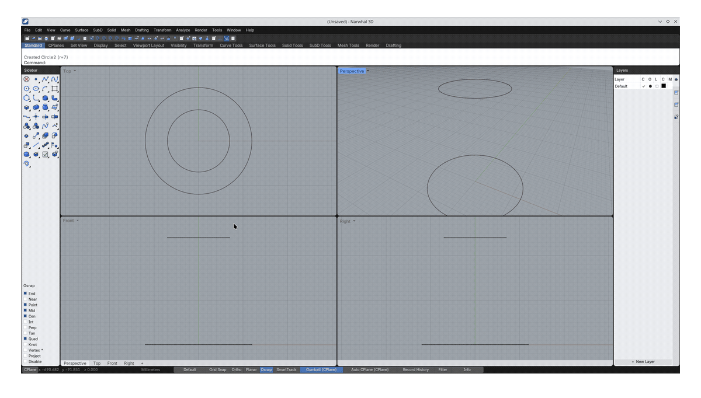

# Narwhal 3D

Narwhal 3D is a free, open-source, command-driven NURBS CAD application. The current release target is Linux x86_64. It ships as one application bundle: a Narwhal launcher and interface on top of a bundled, open-source viewport runtime.

**Licence:** [GPL-3.0-or-later](LICENSE). Contributions and dependencies must be GPL-compatible; see [CONTRIBUTING.md](CONTRIBUTING.md).

> **Project status:** extremely early prerelease. Save important work often and verify manufacturing output before production use. Release numbering is intentionally frozen on the `0.4.x` line until the project owner explicitly lifts that cap.

[Current status](STATUS.md) · [Roadmap](ROADMAP.md) · [Feature gaps](docs/gaps.md) · [Windows build preparation](docs/windows-build.md) · [Experimental macOS source build](docs/macos-build.md) · [Compatibility and independence](COMPATIBILITY.md) · [Contributing](CONTRIBUTING.md) · [Support](SUPPORT.md) · [Security](SECURITY.md)

## Command workflow



The command line, viewport picks, menus, and toolbars all enter the same command system. This example creates two exact NURBS circles, starts `Loft`, chooses both curves, and produces a ruled surface.

## Geometry model

Narwhal keeps document geometry separate from viewport tessellation:

- Curves and analytic primitives are stored as NURBS/Brep document objects.
- Open CASCADE (OCCT) provides exact booleans, fillets, sweeps, STEP I/O, and other solid operations.
- Triangles generated for shaded display are not treated as manufacturing geometry.
- STEP export refuses geometry that has no exact analytic representation.

Narwhal's active project format is `.narwhal`: a dependency-free Rust-validated container holding the complete `.3dm` metadata/document payload plus exact checksum-protected OCCT BReps for every analytic master. It reopens solids directly from those exact payloads without the optional openNURBS writer or recipe reconstruction. `.3dm` remains a supported Import/Open/Export interchange format and uses the MIT-licensed `rhino3dm` package. The public source includes Narwhal's independently authored, bounded ONBREP helper and a build recipe pinned to an exact official openNURBS revision. Release binaries still do **not** bundle the linked helper: official documentation says commercial use is encouraged and unrestricted, while the repository `LICENSE` simultaneously says “All Rights Reserved” without an explicit permission grant. Until that redistribution conflict is cleared, some OCCT-created multi-face solids cannot be encoded as exact `.3dm` Breps by packaged builds. Narwhal reports the limitation when saving; use STEP for exact solid interchange. It never presents a faceted STEP fallback as exact geometry.

## Install on Linux x86_64

The public release artifact is `Narwhal_3D-<version>-x86_64.AppImage`. Version 0.4.2 uses the portable runtime introduced in 0.4.1: every bundled ELF is capped at glibc 2.28, below the Ubuntu 22.04/glibc 2.35 compatibility ceiling enforced by the release verifier.

Make the AppImage executable and run it directly:

```bash
chmod +x Narwhal_3D-0.4.2-x86_64.AppImage
./Narwhal_3D-0.4.2-x86_64.AppImage
```

The AppImage contains the natively branded runtime, locked Python dependencies, application package, icons, and license notices. It does not install a separate host application.

## Early Windows x86_64 preview

The `v0.4.2` prerelease also provides `Narwhal_3D-0.4.2-Windows-x86_64.zip`. Extract the complete folder and start `Narwhal3D.exe`; do not move that executable away from its adjacent `app` and `runtime` folders.

This is an unsigned, portable **early preview**, not an installer or supported production build. Windows SmartScreen may require **More info → Run anyway**. The launcher has original Narwhal icon/version resources and the packaged runtime/bootstrap passes native Windows and offline Wine headless checks, but final physical-GPU/real-window acceptance is pending and the internal viewport runtime still retains some Blender-derived PE resource strings/icons. There are no file associations or automatic installation yet.

## Experimental macOS source build

Narwhal does not yet publish a macOS application. Mac users on macOS 14 or newer can try the [experimental source-build guide](docs/macos-build.md), which builds the pinned Blender runtime and Narwhal Rust helpers for the Mac's current architecture. Exact CPython 3.13 geometry wheels are available for both Apple Silicon and Intel.

The result is an unsigned, unnotarized community build—not a supported release or universal binary—and has not yet passed Narwhal's macOS GUI/GPU, exact-geometry, save/reload, packaging, signing, or notarization gates. Reports from people who compile it are welcome.

## Develop from source

Requirements: Python 3, Bash, HTTPS access, a C/C++ build toolchain, CMake, Ninja, and enough disk space for the runtime and source build.

```bash
./scripts/bootstrap_dev_linux.sh
```

This development bootstrap downloads only SHA-256-locked artifacts and installs the locked wheels into an official development runtime. That runtime is useful for iteration but is deliberately rejected by release assembly because it is not natively branded.

### Current Python layer and native destination

During the 0.x feature-development phase, command behavior, document orchestration, UI, and most tests live in Python. Exact solid operations already use the compiled Open CASCADE kernel, while a small set of Blender source patches provides native application identity and CAD-specific viewport behavior.

After the command set and interaction behavior are feature-complete and stable, the production application layer is intended to move into the Blender source tree and compile as one native Narwhal 3D application. The final product should not require a separately installed or bootstrapped Python add-on. Python may remain for tests, build tooling, and prototypes. Work contributed now remains durable as the behavioral specification, regression coverage, file-format logic, and geometry contract for that native implementation.

See [CONTRIBUTING.md](CONTRIBUTING.md) for the architecture boundaries, exact-geometry rules, and one-command contribution workflow.

`scripts/build_blender_linux.sh` builds the publishable runtime from the exact Blender 5.2.2 source commit and applies the Narwhal title, icon, app-drawn-object, and CAD-boundary patches. See `packaging/README.md` for the required arguments and the current native-build provenance limitation. Install the three wheels from the locked cache into the resulting runtime before packaging.

Once `tools/blender-patched/` exists, run:

```bash
./narwhal3d.sh
./narwhal3d.sh --install
```

## Build a one-click AppImage

With a validated native runtime and the locked appimagetool downloaded:

```bash
python3 scripts/fetch_locked.py \
  --cache-dir ~/.cache/narwhal3d/artifacts \
  appimagetool appimage-runtime

REVISION=$(git rev-parse HEAD)
EPOCH=$(git show -s --format=%ct HEAD)

python3 scripts/assemble_linux_release.py \
  --version 0.4.2 \
  --source-revision "$REVISION" \
  --source-date-epoch "$EPOCH" \
  --runtime-dir tools/blender-patched \
  --native-components-dir runtime/linux-x86_64/bin \
  --appimagetool ~/.cache/narwhal3d/artifacts/appimagetool-x86_64.AppImage \
  --appimage-runtime ~/.cache/narwhal3d/artifacts/runtime-x86_64 \
  --output-dir dist

python3 scripts/verify_linux_release.py \
  dist/Narwhal_3D-0.4.2-x86_64.AppImage \
  --expected-version 0.4.2 \
  --expected-source-revision "$REVISION" \
  --expected-source-date-epoch "$EPOCH"
```

Assembly fails closed unless the native binary identity, patch hashes, source commit, Python dependencies, notices, paths, and symlinks all pass. It emits the AppImage, a SHA-256 sidecar, and a retained AppDir for diagnostics.

## Tests

Fast public model tests can be run with the bundled interpreter after bootstrap. The full application and UI suites use the bundled runtime:

```bash
./run_tests.sh
./uishot.sh
```

The public branch intentionally excludes non-public development corpora, resource-mining tools, internal reports, and tests that require them.

## Report a bug


Open the **Bug Report** tab in the right dock, choose a category, and describe what happened. Press **Report** or `Ctrl+Enter`. Narwhal then:

1. saves a local Markdown report and any opted-in attachments;
2. copies a sanitized report to the clipboard;
3. opens a prefilled [GitHub issue](https://github.com/ContributionRich/Narwhal3D/issues/new) for review.

Narwhal never uploads a screenshot, log, or model automatically. Review the browser form and attach only files that are safe to share. If the browser cannot open, the local report remains saved and the clipboard contains the text to paste manually.

## Supported interchange

Core, self-contained source functionality includes exact `.narwhal` project Save/Open plus `.3dm`, STEP, DXF, SVG, OBJ, STL, and CorelDRAW vector interchange. Built-in v15 Import/Open/Export/Print preserves curves, layers, colours, ordinary widths, and Hairline; v16, v17, and v18 Import/Open and opt-in v17 Export/Print use pinned TraceDraw Rust codec crates compiled into Narwhal's bundled helper. None of those paths requires a separately installed executable or service. Other CDR generations and unsupported structures can use an optional local CLI fallback; PDF and Adobe Illustrator conversion can use an optional converter pack. No vector import route uploads files or silently rasterizes them.

## Repository layout

- `narwhal3d/` — Narwhal commands, document model, geometry bridge, and interface
- `launch/` — startup, desktop integration, MIME registration, and app icon
- `packaging/` — immutable Linux artifact lock and release notes
- `scripts/` — verified bootstrap, assembly, verification, and native-runtime build tools
- `blender_patches/` — focused source patches used by the optional native build
- `spike/` — selected self-contained tests retained on the public branch
- `STATUS.md` — what works in the latest release
- `COMPATIBILITY.md` — narrowly scoped target and independence statement
- `ROADMAP.md` — outcome-based development phases and release gates
- `docs/gaps.md` — detailed living inventory of incomplete and missing capabilities

Internal names such as `narwhal3d`, `narwhal.*`, `rhino3dm`, and `.3dm` are compatibility or file-format interfaces; they are not product branding.

## License and third-party software

Narwhal 3D project code is licensed under **GPL-3.0-or-later**. See `LICENSE`.

The application bundle contains separately licensed open-source components, including Blender, rhino3dm, cadquery-ocp, and Open CASCADE Technology. See `THIRD_PARTY_NOTICES`, `licenses/`, and the bundled runtime's own `license/` directory.

Narwhal 3D is an independent project and is not affiliated with the vendors of the supported file formats or third-party libraries.

## Security and provenance

Release artifacts are built only from the public orphan branch. Do not publish the private development branch or its history. Before release, run `scripts/audit_public_tree.py` and verify that the public root commit has no parent.
