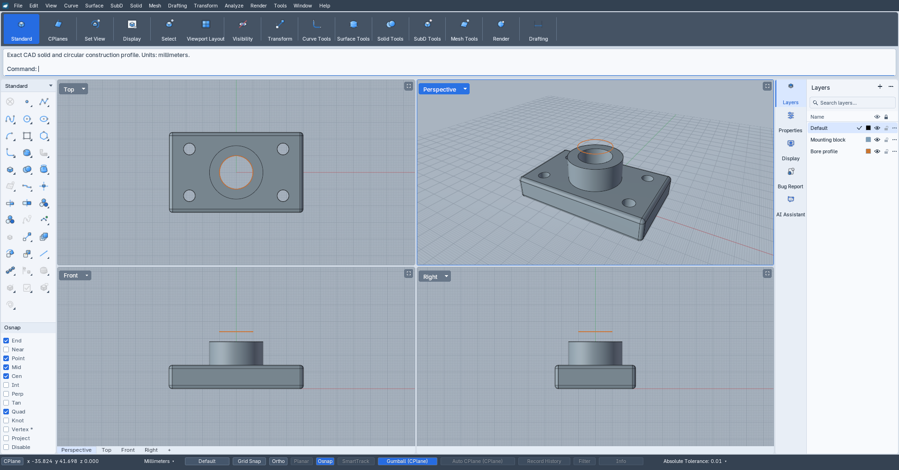
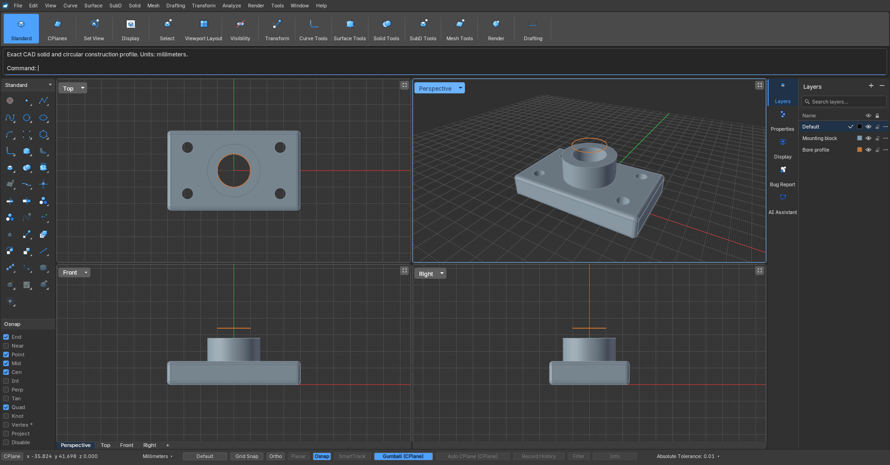

<p align="center">
  
</p>

<h1 align="center">Narwhal 3D</h1>

<p align="center"><strong>Free, open-source CAD for precise curves, smooth surfaces, and solid models.</strong></p>

Draw with the mouse, type a command, or choose a tool from the sidebar. Work in four views at once, shape your model with on-screen handles, and choose a light or dark workspace.

**[Download for Linux](https://github.com/ContributionRich/Narwhal3D/releases/download/v0.4.8/Narwhal_3D-0.4.8-x86_64.AppImage)** · **[Download for Windows](https://github.com/ContributionRich/Narwhal3D/releases/download/v0.4.8/Narwhal_3D-0.4.8-Windows-x86_64.exe)** · **[Download for macOS Apple Silicon](https://github.com/ContributionRich/Narwhal3D/releases/download/v0.4.8/Narwhal_3D-0.4.8-macOS-arm64.dmg)** · [What's new](CHANGELOG.md)

> **Check the release page for available builds.** The 0.4.8 source includes the revised welcome/inspector UI, automatic AI selection context, remembered provider permissions, explicitly approved box creation, newer read-only MCP support and source-only bounded multi-section Sweep1 work. The first Apple Silicon Mac preview is now available, with the platform limitations below. See [current source status](STATUS.md).

> **An early preview, built in the open.** Narwhal is still growing, and some tools are incomplete. Save important work often and verify dimensions and exported geometry before manufacturing. [See what works and what's still missing →](docs/gaps.md)

## Your workspace, light or dark

The same model in **Narwhal 3D 0.4.7**.

### Light

A bright interface with grey viewports and clear outlines.



### Dark

A charcoal workspace with the same tools and layout.



Switch at any time with **View → Theme**. Your choice is remembered the next time you launch.

## From a sketch to a solid

| Start with… | Then… |
|---|---|
| **Curves and profiles** | Draw lines, arcs, circles, and smooth curves with precise coordinates and snapping. |
| **Surfaces** | Extrude a profile, loft between curves, or sweep a section along a rail. |
| **Solid parts** | Combine or subtract shapes, drill openings, and round edges with fillets. |
| **Direct editing** | Move, rotate, scale, and extrude with the gumball—the handles attached to your selection. |

**Precision is more than appearance.** Curved geometry stays smooth and exact; the triangles used to draw the viewport are not a substitute for your model. Unsupported operations should report a limitation rather than silently approximate a result.

[Explore the current features](STATUS.md) · [Read the roadmap](ROADMAP.md) · [Browse the release notes](CHANGELOG.md)

## Get started

### Linux

Download the **AppImage** above. In your file manager, open its properties, allow it to run as a program, and launch it. Or, from the folder containing the download:

```bash
chmod +x Narwhal_3D-0.4.8-x86_64.AppImage
./Narwhal_3D-0.4.8-x86_64.AppImage
```

The application is bundled—no separate Blender installation is needed. The download is for **x86_64 Linux**; desktop and graphics-driver compatibility still varies. [Platform details](docs/technical-reference.md#install-on-linux-x86_64)

### Windows

For 0.4.8, the **portable EXE** manages its payload in a private per-user cache; no manual extraction is required. Its first launch prepares that cache. Keep user documents outside the replaceable application cache.

The existing0.4.8 **portable ZIP** remains on the release page for compatibility; future Windows releases publish only the EXE and checksum. Older ZIP installations need a one-time manual download of the EXE.

This is an **unsigned early preview**, so Windows may display a SmartScreen warning. There is no installer yet, and testing on physical Windows GPUs remains limited. [Windows details](docs/windows-build.md)

### macOS

Download the **Apple Silicon DMG**, open it and drag **Narwhal 3D.app** to Applications. No separate Blender or Python installation is needed. The build targets **macOS14+** and was tested on macOS15; Intel Macs are not supported by this package.

This preview is ad-hoc-signed, **not Developer ID-signed or notarized**. Gatekeeper requires explicit approval: follow Apple’s Privacy & Security instructions for opening an app you trust, rather than disabling Gatekeeper globally. Corel multiversion conversion remains unavailable on Mac. [Mac installation/build details](docs/macos-build.md).

### Try your first model

1. Start a new model and choose a view.
2. Draw a circle using the toolbar or the `Circle` command.
3. Select it, then run `ExtrudeCrv` and enter a distance.
4. Use the gumball handles to move, rotate, or scale the result.
5. Save your project as **`.narwhal`**.

## Save and share your work

- **`.narwhal`** is the native project format. Use it to save and reopen your work.
- **STEP** is the recommended interchange format for exact solid geometry.
- Other supported formats include **`.3dm`, DXF, SVG, OBJ, STL, and CorelDRAW**, with different capabilities and limitations for each.

Some solids cannot yet be exported as exact `.3dm` geometry in packaged builds. Use STEP for exact solid exchange, and check the [format and geometry details](docs/technical-reference.md#geometry-model) before depending on a particular workflow.

## Help shape Narwhal

**Found a bug?** Open the **Bug Report** tab inside the app, or [report an issue on GitHub](https://github.com/ContributionRich/Narwhal3D/issues/new/choose). Include what you were doing, what you expected, and a screenshot if useful. Reports and attachments are not uploaded automatically—you review what you share.

**Have an idea or want to contribute?** Feedback, testing, documentation, design, and code are welcome. Start with the [contribution guide](CONTRIBUTING.md) or [support information](SUPPORT.md).

### For developers and curious readers

[Build instructions, checksums, and technical details](docs/technical-reference.md) · [Packaging guide](packaging/README.md) · [Compatibility](COMPATIBILITY.md) · [Security](SECURITY.md)

---

**Free and open source.** Narwhal 3D is licensed under [GPL-3.0-or-later](LICENSE). It builds on open-source projects including Blender and Open CASCADE; see [third-party notices](THIRD_PARTY_NOTICES). Narwhal 3D is an independent project.
